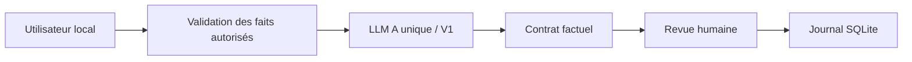
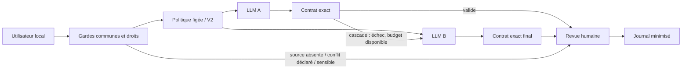

# TP03 — V1, incident et plan V2
Le POC V1 fonctionne avec données autorisées de benchmark, API FastAPI, interface et SQLite. La diffusion est entraînée, comparée aux baselines et évaluée sur un test figé. Voir docs/03_preuve_technique.md et experiments/v1.

La V1 LLM compare A, B et A rédacteur/B vérificateur sur dix cas fictifs. Le contrat est un JSON de copie de faits avec abstention. Résultats : A 0/10, B 1/10, A+B 4/10. Traces brutes dans experiments/llm_v1. L’incident est la production de rapports mal formés ou infidèles et la dégradation possible après vérification.

L’amélioration de prompt a été figée et testée sur douze cas séparés : B seul atteint 8/12, mais la chaîne 1/12. Voir docs/12_amelioration_llm.md. Cette ablation garde les mêmes cas à l’intérieur de chaque expérience, sans mélanger les dénominateurs 10 et 12.

Le TP04 ajoute ensuite une cascade conditionnelle, un routing explicite et des gardes identiques. Les hypothèses et contrôles sont dans docs/05_tp04_architecture_v2.md et le benchmark dans docs/05_tp04_benchmark.md. Ces expériences restent exploratoires. Le dépôt commun est publié ; interlocuteur et contributions réelles restent à décider par le groupe.

## Schémas V1 puis V2 (frontières identiques)

La baseline mono-B reste évaluée séparément. Le schéma ne transforme pas un refus de garde en succès du LLM, et le second modèle n’est pas promu sans bénéfice démontré.
