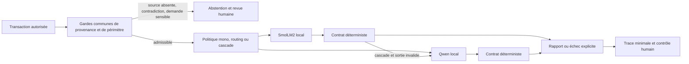

# TP04 — architecture exécutée
Équipe Ahmed, Meriem, Flavio. Interlocuteur principal à désigner.

A : HuggingFaceTB/SmolLM2-360M-Instruct. B : Qwen/Qwen2.5-0.5B-Instruct. Révisions et licences dans configs/llm_models.json ; poids locaux, float32 CPU, 4 threads par worker, décodage glouton, 100 nouveaux tokens. Aucun appel API externe.

Le défaut initial était la faible conformité de A et les erreurs introduites par une vérification systématique. Le nouveau protocole compare quatre stratégies. mono_a et mono_b appellent un seul modèle. Le routing choisit B pour un cas explicitement complexe ou une note non fiable, A sinon. Cette règle se fonde sur les entrées, sans lire la réponse attendue. La cascade appelle A, puis B seulement si le contrat de A échoue. B reçoit les mêmes faits, sans brouillon, afin d’éviter la contamination observée dans le writer/reviewer V1.

Les contrôles sont communs aux stratégies : source absente, contradiction explicitement signalée par le banc de test et demande sensible/hors périmètre provoquent une abstention déterministe. Ce ne sont pas des détections générales de documents contradictoires ou de données personnelles. Les métadonnées sont celles des fixtures. En service, aucune entrée textuelle libre ni action bancaire n’est proposée.

Limites : 2 appels, 0 retry, 2048 tokens d’entrée par appel, 100 tokens de sortie, réserve totale 4600 tokens, 20 s par appel et 45 s par demande hors chargement. Le budget réserve le pire cas avant chaque appel. Un appel dont l’usage est inconnu après panne réserve son plafond. Un processus worker peut être arrêté à l’échéance ; le redémarrage explicite est requis ensuite. La validation exige JSON pur, types numériques corrects, clés uniques et copie exacte des faits. Une sortie rejetée est remplacée par une abstention visible et compte comme échec, même si le JSON de repli est bien formé.

La passerelle limite l’admission à une inférence simultanée ; l’excès reçoit 429. Pas de bascule cloud autorisée. Les anciennes expériences writer/reviewer restent reproductibles dans leurs scripts distincts. Le dashboard interactif utilise désormais les stratégies bornées et le prompt V2.
