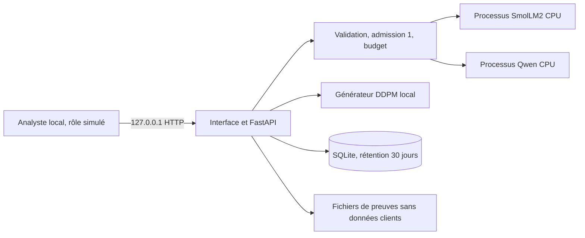

# TP08 — décision de déploiement
Ahmed, Meriem, Flavio. Version du 23 novembre 2026. Décision : **GO sous conditions pour la démonstration locale, NO-GO pour une production bancaire**.

## Contrainte métier et options
Le prototype étudie des transactions anonymisées de benchmark et des fixtures fictives. La demande ne justifie ni un serveur public ni l’envoi de données vers un fournisseur. Le groupe dispose d’un Mac M2 / 8 Go et de deux petits modèles locaux, sans accès cloud fourni. Le choix est l’adaptation du service FastAPI existant, possibilité explicitement prévue par TP08. Docker/Ollama est un parcours recommandé, pas imposé à cette adaptation. Aucun déploiement Docker/GPU n’est revendiqué.

| Option | Données / exploitation | Coût et capacité | Décision |
|---|---|---|---|
| Local sur ordinateur | Prompts et SQLite locaux, accès simulé | Matériel existant, 1 inférence admise, pas de haute disponibilité | Retenu pour POC |
| API managée | Flux externe à contractualiser | Prix et accès non fournis, coûts complets inconnus | Non retenu |
| VM GPU privée | Administration, correctifs, secrets à assurer | GPU et budget non disponibles | Non retenu |
| Hybride | Gouvernance des routes et frontières accrue | Complexité supplémentaire sans besoin démontré | Non retenu |

## Architecture et frontières

Pendant l’inférence, aucun flux externe. Les téléchargements initiaux autorisés passent par OpenML/Hugging Face avec révisions et empreintes. Le serveur écoute exclusivement sur 127.0.0.1. L’API modèle ne possède pas de port propre. Host et Origin sont contrôlés. Aucune authentification forte, TLS, IAM ou disponibilité multi-utilisateur de production n’est implémentée. Ne pas ouvrir ce service au réseau ou à des utilisateurs non autorisés.

## Contrat et objectifs de qualification
/healthz indique uniquement que FastAPI répond. /readyz vérifie que les deux processus chargés sont vivants ; cela ne prouve pas la qualité de leurs réponses. /v1/generate produit une trace_id, le modèle exact, les durées, appels et statut du contrat. Le smoke conserve les identités des modèles et la trace, sans prompt ni sortie libre.

Objectifs pédagogiques proposés avant les tests de charge : augmenter le débit des contrats réussis entre concurrence 1 et 3 sans doubler le p95 ni augmenter les erreurs. Ils ne sont pas des seuils officiels de l’enseignant. Limites de contrôle : 1 inférence simultanée, 2 appels maximum, zéro retry, 20 s par appel et 45 s par demande. L’excès reçoit 429 plutôt qu’une file non bornée. Objectif futur de reprise : moins de 60 s, à confirmer sur davantage d’incidents. Ces mesures ne valident pas un SLO de production.

## Charge réelle
| Concurrence | Tentatives | Contrats réussis | HTTP 429 | p95 toutes tentatives | Débit utile /s |
|---|---|---|---|---|---|
| 1 | 12 | 12 | 0 | 1.993 s | 0.602 |
| 3 | 18 | 1 | 17 | 0.279 s | 0.569 |

Les requêtes sont identiques (hash commun), Qwen seul, décodage glouton, 100 tokens maximum, sans retry. Les preuves CSV/JSON et protocoles sont dans outputs/load_c1 et load_c3. À concurrence 3, les refus rapides font baisser le p95 global ; ils ne signifient pas une amélioration du temps d’inférence. Il n’y a qu’une réponse admise sur ce palier, donc le p95 des seules réponses acceptées n’a pas de portée statistique. Le débit de tentatives inclut les refus et n’est pas le débit utile. L’hypothèse de gain de capacité sans erreurs supplémentaires est rejetée. Conserver une admission de un pour la démonstration.

## Résilience et économie
La panne contrôlée a arrêté le processus writer d’une instance jetable appartenant au script. Pendant la panne, health=200, ready=503, generate=503. Une nouvelle inférence réelle et conforme a suivi le redémarrage. Délai observé depuis la panne jusqu’à cette réponse : 18.61 s. Preuves evidence/incident.json et smoke_before/after_incident.json. La sauvegarde SQLite a été restaurée dans un fichier neuf avec contrôle d’intégrité, evidence/backup_restore.json.

Coût API observé nul ; coût complet réel ND. Voir TP05 et les trois scénarios financiers hypothétiques. Aucun exemple de prix du cours n’est traité comme une facture. Énergie réelle ND, scénarios conditionnels distincts.

## GO / NO-GO et propriétaire
GO sous conditions de supervision locale, données fictives/benchmark, pas d’action bancaire, contrôle des sorties. NO-GO pour production : réussite métier non évaluée humainement, jeux réduits, capacité faible, énergie et coûts complets non mesurés, absence de responsable d’exploitation nommé et absence d’authentification de production. Les membres confirmés sont Ahmed, Meriem et Flavio. L’interlocuteur et les contributions restent à attribuer par le groupe.

Reproduction : README, scripts/service_checks.py et scripts/incident_test.py. Ce dernier crée son instance dédiée sur 8781, la détruit à la fin et ne touche pas aux autres services. Import GitHub reporté à la demande du groupe ; aucun hash Git fictif n’est indiqué.
